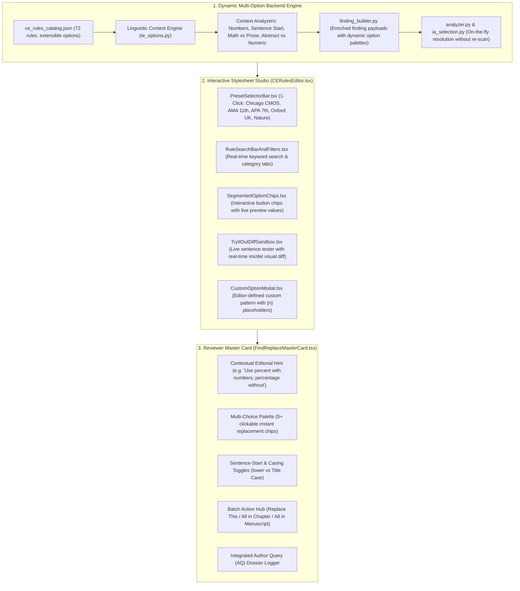

# Universal Copyediting (CE) & Technical Editing (TE) Rules Implementation Plan

## Dynamic Multi-Option Engine, Interactive Studio UI & Production Rollout Specification

**Document Reference:** `CE_rules_tool_input.xlsx` (Reviewed Pre-Editing Checklist — Technical Editing Part 1, Rules 1–91)
**Interactive Prototype:** [`interactive_rules_studio.html`](file:///d:/cms_backend/interactive_rules_studio.html) / [`frontend/public/interactive_rules_studio.html`](file:///d:/cms_backend/frontend/public/interactive_rules_studio.html)
**Target Codebase:** `d:\cms_backend` (FastAPI / SQLAlchemy Backend & React / TypeScript Frontend)
**Status:** Approved Prototype / Ready for Production Implementation

---

## 1. Executive Summary & Architectural Evolution

### 1.1 The Shift from Static 3-Option Dropdowns to an Interactive Multi-Option Studio

The legacy pre-editing checklist constrained each rule to a rigid array of three static choices (`Option 1`, `Option 2`, `Option 3`). Real-world publishing across medical, scientific, and humanistic manuscripts requires flexible, context-sensitive variations:

* **Percentages (`%`)**: Closed `25%` (AMA/Science), Spaced `25 %` (ISO), US Prose `25 percent` (Chicago), UK Prose `25 per cent` (Oxford), Statistical Delta `25 percentage points`, Abstract Proportion `percentage`, or Sentence-Start `Twenty-five percent`.
* **Number Ranges**: En dash closed `10–15`, En dash spaced `10 – 15`, Prose `10 to 15`, Preceded `from 10 to 15`, Preceded `between 10 and 15`, or Hyphen `10-15`.
* **Numbers**: AP/Modern `0–9 spelled, 10+ numerals`, Chicago `0–99 spelled`, AMA/Science `numerals for all quantities with units`, or `spell out at sentence start`.
* **Abbreviations & Latin**: Dotted with comma `e.g.,` & `vs.`, UK undotted `e.g.` & `vs`, English spelled `for example,` & `versus`, or Legal italic `v.`.

### 1.2 End-to-End System Architecture



---

## 2. Validated Prototype & Frontend Component Specifications

The interactive architecture was prototyped and verified in [`interactive_rules_studio.html`](file:///d:/cms_backend/interactive_rules_studio.html). The production React frontend will decompose this architecture into modular components inside `frontend/src/features/stylesheets/` and `frontend/src/features/technicalReview/`:

### 2.1 React Component Hierarchy

```
frontend/src/features/stylesheets/
├── CERulesEditor.tsx                  <-- Main studio container
├── components/
│   ├── PresetSelectorBar.tsx         <-- 1-click house style presets
│   ├── RuleSearchBarAndFilters.tsx   <-- Search input + category pills
│   ├── SegmentedOptionChips.tsx      <-- Dynamic button chips with preview labels
│   ├── TryItOutDiffSandbox.tsx       <-- Live sentence tester with <del>/<ins> diff
│   ├── CustomOptionModal.tsx         <-- Modal for editor-defined custom patterns
│   └── RuleCardItem.tsx              <-- Individual rule card with switch & severity
└── utils/
    ├── presetsCatalog.ts             <-- Chicago, AMA, APA, Oxford, Nature definitions
    └── liveDiffEngine.ts             <-- Client-side instant diff renderer for sandbox
```

### 2.2 Component Responsibilities

1. **`PresetSelectorBar.tsx`**:
   * Renders quick-preset pills: `Chicago Manual (CMOS)`, `AMA 11th Edition (Medical)`, `APA 7th Edition`, `Oxford / Cambridge (UK)`, `Nature / Springer`.
   * Clicking a preset updates options across all 72 rules simultaneously and triggers a toast notification.
2. **`RuleSearchBarAndFilters.tsx`**:
   * Text search: Real-time debounced search matching rule names, descriptions, and keywords (e.g., typing `"per"` matches *Percentage*, *Ampersand*, *Temperatures*).
   * Group tabs: `All (72)`, `Units (6)`, `Numbers (6)`, `Dates (5)`, `Math (4)`, `Abbreviations (5)`, `Nomenclature (7)`, `Headings (3)`, `Callouts (4)`, `Captions (8)`.
   * Filter toggles: `[Show Custom Only]` to inspect deviations from defaults.
3. **`SegmentedOptionChips.tsx`**:
   * Replaces `<select>` dropdowns with interactive horizontal button chips.
   * Displays formatted label and preview tag (e.g., `25%` `(Closed, AMA)` vs `25 percent` `(US Word)`).
   * Includes dashed `[+ Custom]` chip opening `CustomOptionModal`.
4. **`TryItOutDiffSandbox.tsx`**:
   * An editable textarea pre-populated with sample sentences.
   * Runs client-side transformation using active stylesheet options.
   * Renders instant visual diff with `<del>` (soft red strike-through) and `<ins>` (soft green underline).
5. **`FindReplaceMasterCard.tsx` (Review Workspace)**:
   * Displays the dynamic options palette grid for the active finding.
   * Displays a **Contextual Style Hint** banner (e.g., *"Tip: Chicago uses 'percent' in humanistic writing and '%' in scientific tables"*).
   * Provides 1-click batch actions: `[Accept Fix]`, `[Replace All in Chapter (18)]`, `[Replace All in Book (104)]`, `[Query Author]`.

---

## 3. Comprehensive 72-Rule & 28 TE Point Multi-Option Catalog

Below is the exhaustive multi-option mapping across all 14 groups and 28 TE categories:

### Group 1: Units and Measurements (Rules 1–6)

* **Rule 1: SI Unit Standardisation**
  * `s` (SI standard symbol)
  * `sec` / `secs` (abbreviated time)
  * `second` / `seconds` (spelled out)
  * `h` (SI standard hour)
  * `hr` / `hrs` (abbreviated hour)
  * `hour` / `hours` (spelled out)
  * `min` / `mins` / `minute` / `minutes`
  * Dual form with conversion: `25 s (0.42 min)`
  * *Query Author*
* **Rule 2: Unit Symbol Formatting & Casing**
  * `kg` (lowercase kilo, lowercase gram)
  * `mol` (lowercase mole)
  * `L` (capital liter, US/AMA standard)
  * `l` (lowercase liter, UK/European standard)
  * `mL` / `ml`
  * Look-alike symbol correction (`µ` Unicode micro `\u03bc` vs `µ` micro sign `\u00b5`)
  * *Query Author*
* **Rule 3: Space Between Numbers and Units**
  * `25 kg` (standard regular space)
  * `25 kg` (non-breaking space `&nbsp;` / `\u00a0`)
  * `25 kg` (thin space `\u2009`)
  * `25kg` (closed up, per specific journal style)
  * `25-kg` (hyphenated as compound adjective before noun: "a 25-kg payload")
* **Rule 4: Unit Abbreviation Consistency**
  * Style Profile Default (`h, min, s`)
  * Manuscript Majority Form (dominant form dynamically voted across the file)
  * Spell out throughout (`hours, minutes, seconds`)
  * *Query Author*
* **Rule 5: Temperature Formatting**
  * `25 °C` (space + degree + capital C, standard scientific)
  * `25°C` (closed, AMA 11th / clinical style)
  * `25 deg C` / `25 deg. C` (abbreviated without symbol)
  * `25 degrees Celsius` (spelled out)
  * Dual: `25 °C (77 °F)`
  * Sentence start: `Twenty-five degrees Celsius`
* **Rule 6: Percentage Formatting**
  * `25%` (symbol, closed — scientific/AMA standard)
  * `25 %` (symbol, spaced — ISO standard)
  * `25 percent` (spelled single word — Chicago/US prose)
  * `25 per cent` (spelled two words — Oxford/UK prose)
  * `25 percentage points` (delta/difference between percentages)
  * `percentage` / `Percentage` (abstract proportion without number)
  * Sentence start: `Twenty-five percent` / `Percentage of...`

---

### Group 2: Mathematical Symbols & Superscripts (Rules 7–10)

* **Rule 7: Mathematical Operators & Inequalities**
  * True minus sign `−` (`\u2212`) vs hyphen `-`
  * Multiplication sign `×` (`\u00d7`) vs letter `x`
  * Comparison operators: `≤` (`\u2264`), `≥` (`\u2265`), `≠` (`\u2260`), `≈` (`\u2248`)
  * Operator spacing: Spaced `a = b + c` vs Closed `a=b+c`
  * Prefix spacing: Closed `−5°C`, `>100` vs Spaced `> 100`
* **Rule 8: Greek Letter Consistency**
  * Unicode Greek symbol (`α`, `β`, `γ`, `μ`, `δ`, `λ`, `π`, `σ`, `ω`)
  * Spelled out English (`alpha`, `beta`, `gamma`, `delta`, `pi`)
  * Capital Greek (`Α`, `Β`, `Γ`, `Δ`, `Ω`)
  * Italic Greek (mathematical variables: *α*, *β*) vs Roman Greek (particle names: α-particle)
* **Rule 9: Micro Prefix Standardisation**
  * `μg` (Unicode Greek mu `μ`)
  * `mcg` (FDA / Institute for Safe Medication Practices standard to prevent dosing error)
  * `microgram` / `micrograms` (spelled out)
  * `μm` / `micrometer` / `micron`
* **Rule 10: Superscripts and Subscripts**
  * Unicode superscripts/subscripts (`m²`, `CO₂`, `10⁻³`, `Ca²⁺`)
  * HTML tags (`m<sup>2</sup>`, `CO<sub>2</sub>`, `10<sup>-3</sup>`)
  * Plain caret/underscore cleanup (`m^2` $\rightarrow$ `m²`, `CO_2` $\rightarrow$ `CO₂`)

---

### Group 3: Numbers (Rules 11–16)

* **Rule 11: Number Separators (Thousands & Decimals)**
  * `1,000.50` (Comma thousand, Period decimal — US/UK standard)
  * `1 000.50` (Thin space thousand, Period decimal — SI/ISO 31-0)
  * `1000.50` (Closed 4-digit, comma for 5+ digits `10,000`)
  * `1.000,50` (Period thousand, Comma decimal — European standard)
  * `1000` (Never separate 4-digit years or page numbers)
* **Rule 12: Decimal Precision (Never Auto-Fix)**
  * Keep as reported (preserve scientific precision)
  * Uniform 2 decimal places (`3.10`, `4.50`) — *Author confirmation required*
  * Uniform 1 decimal place (`3.1`, `4.5`) — *Author confirmation required*
  * *Query Author: Confirm significant figures*
* **Rule 13: Number Style (Words vs. Numerals)**
  * Words for 0–9, numerals for 10+ (AP / Modern Scientific standard)
  * Words for 0–99, numerals for 100+ (Chicago Manual of Style literary standard)
  * Numerals for all quantities with units (`5 mg`, `3 days`, `2 hours` — AMA standard)
  * Always spell out at sentence start (`Twenty-four patients...`)
  * Consistent in category ("5 apples and 12 oranges" vs "five apples and 12 oranges")
* **Rule 14: Number Range Formatting**
  * `10–15` (En dash, closed — Chicago/AMA standard)
  * `10 – 15` (En dash, spaced — UK/French standard)
  * `10 to 15` (Spelled "to" — Recommended in running prose)
  * `from 10 to 15` (If preceded by "from": never "from 10–15")
  * `between 10 and 15` (If preceded by "between": never "between 10–15")
  * `10-15` (Hyphen-minus — Code/computing contexts)
* **Rule 15: Negative Number Formatting**
  * `−5` (True Unicode minus `\u2212`)
  * `–5` (En dash `\u2013`)
  * `-5` (Hyphen-minus)
  * `negative 5` / `minus 5` (spelled out)
* **Rule 16: Fractions and Ratios**
  * `1/2` (Slash fraction)
  * `½` (Vulgar Unicode fraction)
  * `one-half` / `three-quarters` (hyphenated spelled out in running text)
  * `3:1` (Ratio with colon, closed)
  * `3 to 1` (Spelled ratio in prose)

---

### Group 4: Dates, Times, and Currency (Rules 17–21)

* **Rule 17: Date Format Standardisation**
  * `10 October 2026` (Day Month Year — UK / International)
  * `October 10, 2026` (Month Day, Year — US standard with comma)
  * `2026-10-10` (ISO 8601 — Data, tables, bibliographies)
  * `10/10/2026` (Numeric UK: DD/MM/YYYY)
  * `10/10/2026` (Numeric US: MM/DD/YYYY)
  * `10th October 2026` / `October 10th, 2026` (Ordinal date)
  * `Oct. 10, 2026` / `10 Oct. 2026` (Abbreviated month)
* **Rule 18: Date Consistency**
  * Apply manuscript primary format across all chapters, tables, and figures
  * Allow ISO dates in tables, long dates in text
  * *Query Author: Incompatible dates detected*
* **Rule 19: Time Format Standardisation**
  * `3:30 p.m.` (12-hour with lowercase dotted a.m./p.m. — Chicago standard)
  * `3:30 pm` (12-hour with lowercase undotted am/pm — UK/Modern standard)
  * `3:30 PM` / `3:30 P.M.` (Small-caps or uppercase)
  * `15:30` (24-hour military/scientific notation)
  * `15:30:00` (24-hour with seconds)
  * `half past three` (spelled out in literary text)
* **Rule 20: Time Zone Formatting**
  * Standard abbreviation: `UTC`, `EST`, `GMT`, `PST`
  * Offset notation: `UTC+05:30`, `UTC-05:00`
  * Spelled out: `Eastern Standard Time`, `Coordinated Universal Time`
* **Rule 21: Currency Formatting**
  * `$50` / `$5 million` (Symbol before amount, no space — US/UK)
  * `$ 50` (Symbol with space)
  * `50 €` (Euro symbol after amount with space — European style)
  * `USD 50` / `EUR 50` / `GBP 50` (ISO 4217 code)
  * `50 dollars` / `fifty dollars` (spelled out)

---

### Group 5: Equations, Chemical Formulae & Statistics (Rules 22–26)

* **Rule 22: Mathematical Equation References**
  * `Equation (1)` (Spelled out with parentheses)
  * `Eq. (1)` / `Eq. 1` (Abbreviated)
  * `(1)` (Number only in parentheses)
  * `Equation 1` (Spelled out without parentheses)
* **Rule 23: Chemical Formula Formatting**
  * True sub/superscripts: `H₂O`, `CO₂`, `Ca²⁺`, `SO₄²⁻`
  * Case correction: `NaCl` (not `NACL`), `Fe₂O₃`
  * Spelled out: `water`, `carbon dioxide`, `calcium ion`
* **Rule 24: Scientific Notation**
  * `3.2 × 10⁵` (Times symbol with superscript exponent — Scientific prose)
  * `3.2 · 10⁵` (Middle dot with superscript exponent)
  * `3.2E5` / `3.2e5` (Exponential notation — Tables & data files)
* **Rule 25: Statistical Notation**
  * `p < .05` (Italic lowercase *p*, space around operator, no leading zero — APA 7th)
  * `P < 0.05` (Italic uppercase *P*, space around operator, leading zero — AMA 11th)
  * `p<0.05` (Closed spacing)
  * `p = .042` (Exact p-value reporting)
  * Variables italicized: *N*, *n*, *t*, *F*, *z*, *r*, *df*, *SD*, *SE*
  * Roman symbols: Greek letters (β, α, χ²), subscripts that are words (*F*~max~)

---

### Group 6: Measurement Consistency & Conversions (Rules 27–30)

* **Rule 27: Measurement Consistency**
  * Metric throughout (`mg`, `km`, `mL`)
  * Imperial throughout (`oz`, `miles`, `gal`)
  * Dual: Metric with Imperial in parentheses: `25 km (15.5 miles)`
  * Dual: Imperial with Metric in parentheses: `50 psi (345 kPa)`
* **Rule 28: Non-SI Conversion Verification (Never Auto-Fix)**
  * Keep as reported
  * Insert calculated SI equivalent in parentheses: `100 psi (689 kPa)` — *Editor confirmation*
  * *Query Author: Confirm conversion*
* **Rule 29: Tolerance & Spacing**
  * `5 ± 0.2 mm` (Spaced ± symbol)
  * `5±0.2 mm` (Closed ± symbol)
  * `5 mm ± 0.2 mm` (Repeated unit on both values)
  * `(5 ± 0.2) mm` (Parentheses enclosing values with single unit)
* **Rule 30: Degree Symbol Formatting**
  * `°` (`\u00b0` True degree symbol)
  * `º` (`\u00ba` Masculine ordinal indicator — Incorrect, replace with `°`)
  * `degrees` (spelled out in prose)
  * Coordinates: `40° 26′ 46″ N` (Degree, prime, double prime)

---

### Group 7: Abbreviations and Acronyms (Rules 31–35)

* **Rule 31: First-Use Abbreviation Expansion**
  * `Full Name (ABBR)`: "World Health Organization (WHO)"
  * `Full Name [ABBR]`: "World Health Organization [WHO]" (inside parentheses)
  * `ABBR (Full Name)`: "WHO (World Health Organization)"
  * Do not abbreviate (spell out on every occurrence)
* **Rule 32: Subsequent Abbreviation Reuse**
  * Use abbreviation consistently after first introduction
  * Re-define in Abstract, and re-define again at first mention in Main Text
  * Keep spelled out in Section Headings
* **Rule 33: Abbreviation List Cross-Check**
  * Add missing acronym to the Abbreviation List
  * Delete unused acronym from the Abbreviation List
  * *Query Author*
* **Rule 34: Acronym Capitalisation**
  * All caps: `WHO`, `NASA`, `AIDS`, `COVID-19`
  * Small caps: `who`, `nasa`
  * Lowercase lexicalized words: `laser`, `radar`, `scuba`, `sonar`
  * Title Case: `Covid-19`, `Aids` (UK Guardian/BBC style)
* **Rule 35: Latin Abbreviations & Versus**
  * `e.g.,` (with trailing comma — US standard)
  * `e.g.` (without comma — UK standard)
  * `for example,` (spelled out in English)
  * `i.e.,` (with comma) vs `i.e.` vs `that is,`
  * `et al.` (period after al, no period after et) vs *et al.* (italicized)
  * `etc.` vs `and so on`
  * `versus` (spelled out in text)
  * `vs.` (abbreviated with period — US)
  * `vs` (abbreviated without period — UK)
  * `v.` (italicized single letter — legal citations: *Brown v. Board of Education*)

---

### Group 8: Nomenclature & Terminology (Rules 36–42, 46–47)

* **Rule 36: Binomial Scientific Nomenclature**
  * Full italicized: *Homo sapiens*, *Escherichia coli*
  * Abbreviated genus after first use: *H. sapiens*, *E. coli*
  * Roman with italic species: *Homo* sp., *Streptococcus* spp.
  * Higher taxa in Roman with initial capital: Mammalia, Hominidae
* **Rule 37–42: Medical & Chemical Nomenclature**
  * Generic drug names in lowercase: `ibuprofen`, `acetaminophen`, `atorvastatin`
  * Brand names with initial capital + generic in parentheses: `Advil (ibuprofen)`, `Tylenol (paracetamol)`
  * Gene symbols in italics (*BRCA1*, *TP53*) vs Protein symbols in Roman (BRCA1, p53)
  * Anatomical terms: English common name vs Latin standard (*Terminologia Anatomica*)
* **Rule 46: Trademarked Product Names**
  * Correct proprietary casing: `iPhone`, `iPad`, `PowerPoint`, `GitHub`, `YouTube`, `macOS`
  * Generic equivalent: `smartphone`, `presentation software`, `code repository`

---

### Group 9: Trademarks, Symbols & Special Characters (Rules 43–45)

* **Rule 43: Trademark (™) and Registered (®) Symbols**
  * Omit symbols throughout (Standard academic/publisher style)
  * Keep symbol on first mention only, omit on subsequent mentions
  * Retain symbols on every mention
* **Rule 44: Copyright Notices**
  * `© 2026 Publisher Name` (Symbol + Year + Owner)
  * `Copyright © 2026 Publisher Name`
  * `Copyright 2026 by Publisher Name`
* **Rule 45: Mojibake & Encoding Corruption Correction**
  * Quotations: `’` $\rightarrow$ `’`, `‘` $\rightarrow$ `‘`, `“` $\rightarrow$ `“`, `†` $\rightarrow$ `”`
  * Dashes: `–` $\rightarrow$ `–` (en dash), `—` $\rightarrow$ `—` (em dash)
  * Symbols: `é` $\rightarrow$ `é`, `ü` $\rightarrow$ `ü`, `°` $\rightarrow$ `°`, `±` $\rightarrow$ `±`, `×` $\rightarrow$ `×`, `µ` $\rightarrow$ `μ`

---

### Group 10: Headings & Hierarchy (Rules 68–70)

* **Rule 68: Heading Hierarchy Progression**
  * Strict hierarchy (`H1` $\rightarrow$ `H2` $\rightarrow$ `H3` without skipping)
  * Demote skipped levels (`H1` followed by `H3` $\rightarrow$ demote `H3` to `H2`)
  * *Query Author: Check heading structural order*
* **Rule 69: Heading Numbering**
  * Numbered decimal: `1.`, `1.1`, `1.1.1`
  * Numbered legal/alphanumeric: `I.`, `A.`, `1.`, `a.`
  * Unnumbered (remove numbers and style with bold/typography)
* **Rule 70: Heading Capitalisation**
  * Sentence case: "Methods and materials for clinical trials"
  * Title case (Chicago): "Methods and Materials for Clinical Trials"
  * Title case (Minimal): capitalize words 4+ letters
  * UPPERCASE: "METHODS AND MATERIALS"

---

### Group 11: Numbering, Callouts & Assets (Rules 71–82)

* **Rule 71 & 72: Table and Figure Numbering**
  * Consecutive Arabic: `Table 1`, `Table 2`; `Figure 1`, `Figure 2`
  * Chapter-prefixed: `Table 1.1`, `Table 1.2`; `Figure 3.1`
  * Consecutive Roman: `Table I`, `Table II`
* **Rule 73 & 74: Asset Callouts**
  * Insert missing in-text callout near first mention: `(Table 1)` or `as seen in Figure 2`
  * Spell out: `Figure 1` vs Abbreviate: `Fig. 1` vs Plural: `Figures 1 and 2` vs `Figs. 1 and 2`
  * *Query Author: Figure/Table cited but asset not found*
* **Rule 75 & 76: Table and Figure Captions**
  * Format: `Table 1. Title` (period separator)
  * Format: `Table 1: Title` (colon separator)
  * Format: `Table 1 — Title` (em dash separator)
  * Format: `TABLE 1. Title` (all-caps label)
  * Table caption placement: Above table; Figure caption placement: Below figure
* **Rule 78: Table Footnote Markers**
  * Lowercase superscript letters: `ª, ᵇ, ᶜ` (Chicago / APA standard)
  * Traditional symbols sequence: `*, †, ‡, §, ¶, #, **`
  * Lowercase numbers: `¹, ², ³`

---

### Group 12: Content Integrity, Duplicates & Queries (Rules 83–91)

* **Rule 84: Duplicate Paragraphs & Passages**
  * Delete second and subsequent duplicate occurrences
  * Merge duplicate occurrences with cross-reference
  * *Query Author: Duplicate content detected across chapters*
* **Rule 89: Temporary Placeholders**
  * Detect `TK`, `TBD`, `[insert figure here]`, `[ref]`, `XXX`
  * Highlight and generate mandatory Author Query
  * Replace with supplied file asset

---

## 4. Backend Engine Refactor Specifications

### 4.1 Extensible Option Schema in `ce_rules_catalog.json`

Every rule catalog entry transitions from a simple string array to an array of option descriptors:

```json
{
  "sno": 14,
  "name": "Number Range Formatting",
  "group": "Numbers",
  "default_option_id": "endash",
  "options": [
    { "id": "endash", "label": "10–15 (En dash, closed)", "preview": "10–15", "style": "Chicago / AMA" },
    { "id": "endash_spaced", "label": "10 – 15 (En dash, spaced)", "preview": "10 – 15", "style": "UK / French" },
    { "id": "to", "label": "10 to 15 (Prose)", "preview": "10 to 15", "style": "General Prose" },
    { "id": "from_to", "label": "from 10 to 15", "preview": "from 10 to 15", "style": "Enforced with 'from'" },
    { "id": "between_and", "label": "between 10 and 15", "preview": "between 10 and 15", "style": "Enforced with 'between'" },
    { "id": "hyphen", "label": "10-15 (Hyphen-minus)", "preview": "10-15", "style": "Code / Computing" },
    { "id": "custom", "label": "Custom replacement...", "is_custom": true }
  ]
}
```

### 4.2 Dynamic Option Generator in `app/processing/manuscript_core/rules/te_options.py`

Refactor `te_options.py` into a dynamic palette builder:

```python
def get_te_replacements_by_option(rule_id: str, m: re.Match) -> dict[str, str | None]:
    """Generates literal replacement texts keyed by option ID for a match."""
    # 1. Extract context: numbers, prefix words ("from", "between"), sentence start
    ctx = parse_match_context(m)
  
    # 2. Route to specialized category generators
    if rule_id.startswith("percent_"):
        return generate_percent_palette(ctx)
    if rule_id.startswith("range_"):
        return generate_range_palette(ctx)
    if rule_id.startswith("date_"):
        return generate_date_palette(ctx)
    if rule_id.startswith("latin_") or rule_id.startswith("versus_"):
        return generate_latin_palette(ctx)
    if rule_id.startswith("unit_"):
        return generate_unit_palette(ctx)
  
    # ... fallback to default option replacements
```

### 4.3 Stylesheet Service Persistence

The `ProjectStylesheet.ce_rules` JSON column continues to store sparse overrides, supporting string option IDs and custom templates:

```json
{
  "6": { "option_id": "uk_word", "severity": "Minor" },
  "14": { "option_id": "custom", "custom_template": "{a} through {b}" },
  "84": { "enabled": false }
}
```

---

## 5. Phased Production Implementation Schedule

```
Sprint 1 (Backend Core):
├── Step 1.1: Refactor ce_rules_catalog.json with structured option descriptors
├── Step 1.2: Upgrade te_options.py to generate dynamic multi-choice palettes
├── Step 1.3: Update IA_ROW_TO_CE in ce_rules.py to map all IA patterns
└── Step 1.4: Expand pytest test suite (tests/test_te_ce_rules.py)

Sprint 2 (Frontend Studio Overhaul):
├── Step 2.1: Implement PresetSelectorBar.tsx (CMOS, AMA, APA, Oxford, Nature)
├── Step 2.2: Implement RuleSearchBarAndFilters.tsx with instant debounced filtering
├── Step 2.3: Implement SegmentedOptionChips.tsx with keyboard navigation
├── Step 2.4: Implement TryItOutDiffSandbox.tsx with live regex ins/del diff
└── Step 2.5: Integrate into StylesheetFormDrawer.tsx and StylesheetsPage.tsx

Sprint 3 (Review Workspace Master Card):
├── Step 3.1: Upgrade FindReplaceMasterCard.tsx with dynamic option palette grid
├── Step 3.2: Add sentence-start casing toggle & contextual style hint banner
└── Step 3.3: Connect 1-click batch actions (Replace in Chapter / Replace in Book)

Sprint 4 (Testing & Deployment):
├── Step 4.1: Run alembic upgrade head
├── Step 4.2: Run npm --prefix frontend run build & typecheck
└── Step 4.3: End-to-end review with real production DOCX manuscripts
```

---

## 6. Verification & Acceptance Criteria

| Checkpoint                  | Target Behavior                                                                                          | Acceptance Standard                                                |
| :-------------------------- | :------------------------------------------------------------------------------------------------------- | :----------------------------------------------------------------- |
| **Preset Switching**  | Selecting "Oxford UK" changes `%` to `per cent`, dates to `10 October 2026`, and `vs.` to `vs` | All 72 rules update in < 50ms without page reload                  |
| **Live Diff Sandbox** | Typing `25% at 25 C` renders `<del>25%</del><ins>25 percent</ins>`                                   | Updates on every keystroke and option chip click                   |
| **Custom Options**    | Adding custom template `{n} percentage points`                                                         | Saves to DB, displays in review card, applies cleanly              |
| **Review Workspace**  | Clicking a finding in `FindReplaceMasterCard` displays 5+ option buttons                               | 1-click apply replaces text, updates diff, scrolls to next finding |
| **Batch Replace**     | Clicking `[Replace All in Chapter]`                                                                    | Replaces all identical occurrences in chapter with tracked changes |
